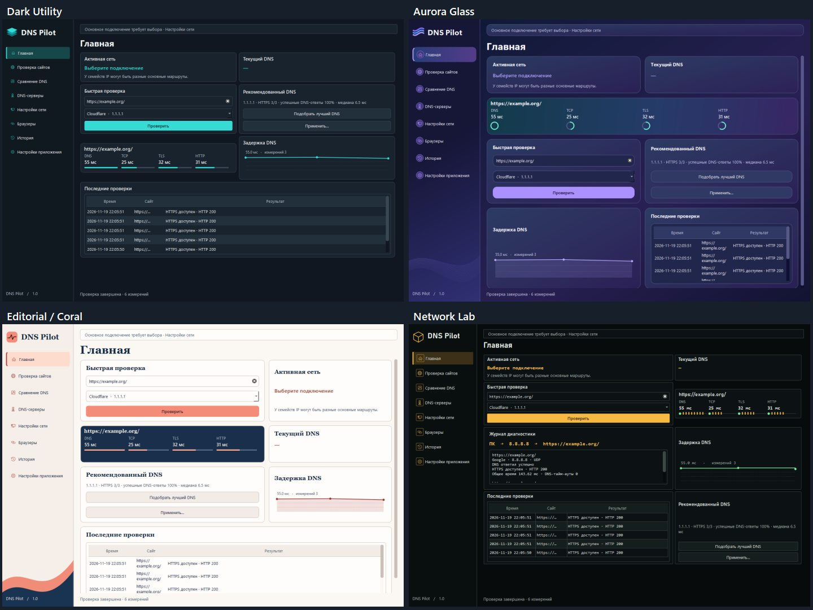

# DNS Pilot 1.2.0

Настольный DNS-менеджер для Windows 10/11 x64 с русским интерфейсом. Проверьте, какой адрес вернёт конкретный DNS, пройдёт ли соединение TLS и какой HTTP-код отдаст сайт. Сетевые настройки можно менять отдельно, после просмотра и подтверждения.



## Запуск

Откройте последний успешный запуск сборки и скачайте архив **DNS-Pilot-1.2.0-Windows-x64** из раздела **Artifacts**. Распакуйте его и запустите **DNS Pilot.exe**. Для загрузки артефактов GitHub может потребоваться вход. В локальной сборке программа находится в папке **dist/1.2.0**. Python для запуска EXE не требуется. [Сборки Windows](https://github.com/OUltraBlazeeO/dns-pilot/actions/workflows/windows.yml)

Перед запуском сверьте SHA-256 файла из архива с `SHA256SUMS.txt` командой `Get-FileHash -Algorithm SHA256 -LiteralPath '.\DNS Pilot.exe'`. [Изменения в версии 1.2.0](RELEASE-NOTES.md)

## Что можно проверить

- **Сайт через выбранный DNS.** Приложение получает A/AAAA по UDP с переходом на TCP или через DoH. Для HTTPS оно подключается к полученному IP и проверяет TLS с исходным именем сайта. Имена в перенаправлениях разрешаются тем же DNS.
- **Свой DNS.** Откройте **DNS-серверы → Добавить DNS**. Введите название, основной и резервный IPv4 или IPv6 либо HTTPS URL для DoH. **Проверить соединение** покажет ответ и задержку каждого адреса. После сохранения профиль доступен для диагностики, сравнения и настройки адаптера.
- **Сравнение.** Выберите от 2 до 20 DNS и обязательные сайты. Таблица показывает разрешение имён, фактическую HTTPS-доступность, стабильность и медиану задержки.
- **DNS адаптера.** Выберите подключение и семейство IP, проверьте будущие адреса и подтвердите изменение. Приложение сохраняет резервную копию и проверяет доступ через системный резолвер после записи. Права администратора нужны только для операции Windows.
- **История.** Результаты и технические подробности хранятся локально. Для экспорта доступны CSV и JSON.

## Оформление

Выберите миниатюру в **Настройки приложения → Оформление**. Тема меняется сразу и сохраняется между запусками.

| Тема | Характер интерфейса |
|---|---|
| **Dark Utility** | Графитовые панели, бирюзовые акценты, компактные таблицы. Выбрана по умолчанию. |
| **Aurora Glass** | Сине-фиолетовые переходы, полупрозрачные панели и кольцевые индикаторы времени. |
| **Editorial / Coral** | Кремовый фон, тёмно-синий блок диагностики, заголовки с засечками и коралловые акценты. |
| **Network Lab** | Моноширинные данные, схема запроса, журнал этапов и ступенчатый график задержки. |

## Сборка из исходников

На Windows с Python x64 3.12–3.14 откройте PowerShell в корне проекта и выполните:

```powershell
.\build.ps1
```

Скрипт создаёт виртуальное окружение, устанавливает зависимости, запускает pytest, собирает EXE с помощью PyInstaller и проверяет его запуск. Стек приложения — Python, PySide6, dnspython, h11 и SQLite.

[Руководство пользователя](GUIDE.md) · [Интеграционные проверки Windows](MANUAL-TESTS.md)
